  

  <a href="https://www.melboonchan.com">melboonchan.com</a> ·
  <a href="https://x.com/melboonchan">x</a> ·
  <a href="https://youtube.com/melboonchan">youtube</a> ·
  <a href="https://www.youtube.com/@muunkk">munk</a>

<!-- The card is generated: edit INFO in generate.py, then run `python3 generate.py`. -->
